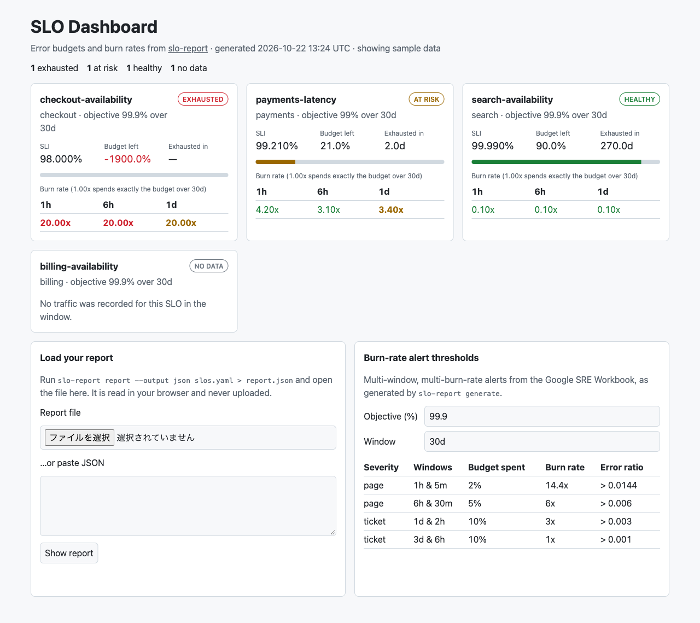

# slo-dashboard

[](https://github.com/OTA-EITA/slo-dashboard/actions/workflows/ci.yml)
[](https://securityscorecards.dev/viewer/?uri=github.com/OTA-EITA/slo-dashboard)

[slo-report](https://github.com/OTA-EITA/slo-report) のエラーバジェットのレポートを可視化する、React + TypeScript 製のダッシュボードです。

**デモ: https://ota-eita.github.io/slo-dashboard/**



## できること

- **SLO ごとの状態**: SLI、エラーバジェットの残量（ゲージ）、バーンレート、バジェットが尽きるまでの時間、判定（EXHAUSTED / AT RISK / HEALTHY / NO DATA）を、悪い順に表示
- **アラート水準の色分け**: 各ウィンドウのバーンレートを、SRE Workbook の複数ウィンドウ・バーンレートの閾値（1h は 14.4 倍で page、1d は 3 倍で ticket など）と比べて色分け
- **閾値の計算機**: 目標値と期間を入力すると、`slo-report generate` が作るアラートの閾値（バーンレートとエラー率）をその場で計算
- **自分のレポートを表示**: `slo-report report --output json` の出力をファイルで開くか貼り付けて表示。データはブラウザ内だけで処理し、どこにも送信しません

## 使い方

```sh
slo-report report --prometheus http://prometheus:9090 --output json slos.yaml > report.json
```

[デモ](https://ota-eita.github.io/slo-dashboard/)を開き、「Load your report」で `report.json` を選びます。

## 設計のポイント

- **入力は信頼しない**: 読み込んだ JSON は型ガードで検証し、欠けている項目や型の誤りは、どの SLO のどの項目かを示すエラーにする（[`src/report.ts`](src/report.ts)）
- **計算ロジックを UI から分離**: バーンレートの閾値計算は純粋関数で、slo-report の Go 実装と同じ Workbook の値（14.4 / 6 / 3 / 1）を再現することをテストで確認（[`src/burn.ts`](src/burn.ts)）
- **アクセシビリティ**: ゲージは `role="meter"`、入力はラベルと関連付け、エラーは `role="alert"` で読み上げ、色だけに頼らずアラート水準をテキストでも提示。ライト / ダークの両テーマとスマホ幅に対応
- **型の厳しさ**: `strict` に加えて `noUncheckedIndexedAccess` と `exactOptionalPropertyTypes` を有効にし、typescript-eslint の `strictTypeChecked` で lint

## 開発

```sh
npm ci
npm run dev        # http://localhost:5173/slo-dashboard/
npm run coverage   # Vitest + Testing Library（カバレッジのしきい値つき）
npm run build
```

main への push で GitHub Pages に自動でデプロイされます（[`.github/workflows/pages.yml`](.github/workflows/pages.yml)）。

## License

MIT
